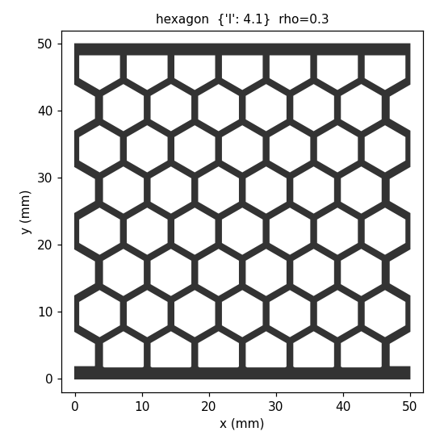
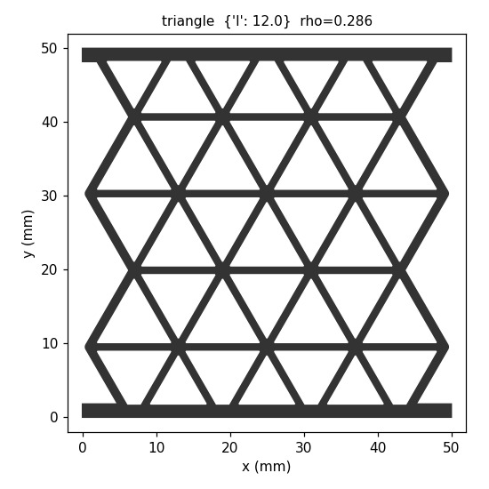
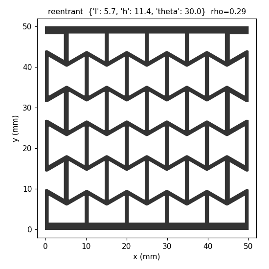

# Agentic In-Process Redesign

Can an AI agent rescue a 3D print after a defect appears, by changing the part of the design that hasn't been printed yet?

This research project tests that idea on lattices (open, repeating cell structures used to absorb crushing forces). The goal is for the finished part to respond to compression like a healthy part, even though a defect is already built into it.

**Status:** work in progress. All results so far are estimates from a formula. No repaired part has been simulated in detail or crush-tested yet.

<p align="center">
  
  
  
</p>
<p align="center"><em>The three lattice designs, seen from above: 50 × 50 mm, 10 mm tall, with walls 1.2 mm thick.</em></p>

## The problem

A 3D printer builds a part one layer at a time. If a defect appears partway through, the usual choices are to scrap the print or to finish it and accept a weaker part.

The lower layers can't be changed, but the upper layers haven't been printed yet. This project asks whether changing those upper layers can make up for the defect, using no more plastic than the original design would have used.

## How it works

1. **Design the lattices.** Each design is stored as a graph (points joined by walls), then converted to an STL file, the 3D model format printers use.
2. **Add printing defects.** There are four types:
   - under-extrusion (too little plastic, so walls come out thin)
   - over-extrusion (too much plastic, so walls come out thick)
   - layer shift (the upper layers are printed off to one side)
   - warpage (the bottom corners lift off the print bed)
3. **Stop the print.** Each test case cuts the part off 1 mm above where the defect starts, as if a camera had just noticed it.
4. **Propose a fix.** A method chooses a wall thickness for each remaining 1 mm of height.
5. **Check the fix against the rules.** Walls must be 0.8 to 2.0 mm thick, a wall can't grow more than 0.4 mm over the one below it, and the fix can't use more plastic than the original design would have used for that height. A rejected AI answer goes back to the agent with the reasons, up to 3 attempts in total.
6. **Score the finished part.** A formula estimates stiffness (resistance to being squeezed) along the loading direction, as a percentage of a healthy part. The target is 100%, and being too stiff counts as error too. Peak force (the most load the part can take) is estimated as well, and the agent can't see it.

## Results so far

This comparison covers the re-entrant lattice with 3 repeated runs for each AI agent. The agents used one free model, Nemotron 3 Ultra.

The table shows the 6 under- and over-extrusion cases, because the score can't see layer shift and barely registers warpage. Lower is better.

| Method | Uses AI? | Average distance from a healthy part's stiffness |
|---|---|---|
| Keep the original design | No | 5.86% |
| Agent without a calculator | Yes | 5.27% |
| Agent with a calculator (10 uses) | Yes | 2.15% |
| Search with the same calculator (10 uses) | No | 1.91% |
| Simple correction rule | No | 1.34% |
| Search with 200 calculator uses | No | 0.79% |

**What this shows:**
- Letting the agent check its designs with a calculator cut its error by more than half.
- The agent still did not beat the non-AI methods. Against the simple rule it had 0 wins, 3 ties and 3 losses. Against the 10-use search it had 2 wins, 2 ties and 2 losses.
- So when only wall thickness can change, AI adds no clear value over simple methods. The harder test, still to come, is letting the agent change more of the design.

**Limits of these results:**
- The scores come from a formula, not from a detailed simulation or physical tests.
- The calculator's stiffness estimate uses the same formula as the score, so the agent can aim directly at it.
- Three runs per case is a small sample.
- The model ran with its long hidden reasoning turned off, which may understate what it can do.

The full table for all 12 cases, including peak force, is in [`out/results/e6_table.md`](out/results/e6_table.md).

## What's next

- Build a better evaluator using finite element analysis (FEA, a detailed physics simulation), and check it against physical crush tests of printed parts.
- Use that evaluator to explore recursive self-improvement, where the agents improve their own setup.
- Test prompt changes one at a time.
- Let the agent redesign more than wall thickness.

## Repository guide

| Path | What it holds |
|---|---|
| `lattice.py`, `build_base.py` | Build the three defect-free lattices |
| `defects.py`, `build_defects.py` | Add defects and build the full set of 63 defect parts |
| `view_graph.py` | Draw a design's graph |
| `agent/scenarios.py` | Builds the 12 stopped-print test cases |
| `agent/evaluate.py` | Checks a fix against the rules and scores it |
| `agent/baselines.py`, `agent/search.py` | The non-AI methods |
| `agent/agent_v0.py`, `agent/agent_v1.py` | The AI agents, without and with the calculator |
| `agent/prompts/` | Every prompt version |
| `out/` | Generated parts, run logs and results |
| [`docs/progress.md`](docs/progress.md) | Progress summary by week |
| [`docs/experiments.md`](docs/experiments.md) | Each experiment: question, prediction, result |
| [`docs/decisions.md`](docs/decisions.md) | Design decisions and the reasons for them |
| [`docs/pipeline_diagrams.md`](docs/pipeline_diagrams.md) | Diagrams of each stage and agent version |
| [`docs/week2_defects.md`](docs/week2_defects.md) | Lattice and defect choices, with sources |

## Running it

Generated parts and results are already in `out/`, so you can read them without running anything.

Install the packages:

```bash
pip install -r requirements.txt
```

Rebuild the parts and rerun the non-AI methods (plain Python, no AI):

```bash
python build_base.py
python build_defects.py
python agent/scenarios.py
python agent/baselines.py
python agent/search.py
```

Run an AI agent on the cases whose defect starts at 10% of the height. This needs an [OpenRouter](https://openrouter.ai) key in the environment variable `OPENROUTER_API_KEY`:

```bash
python agent/agent_v1.py --cases z10 --runs 1
```

## About

Research by Amber Li, an undergraduate in industrial engineering at Georgia Tech. I work on lattice design, defect modeling and agent design. My mentor's research group handles printing and data collection.
