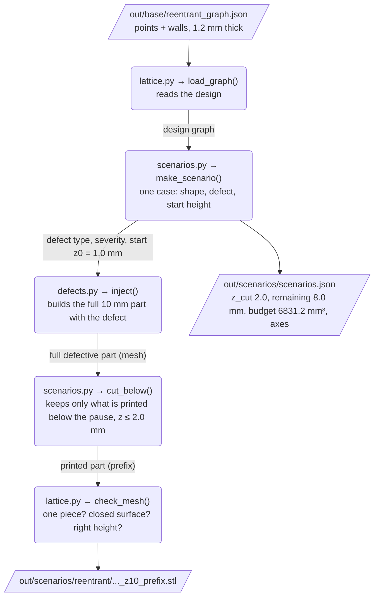
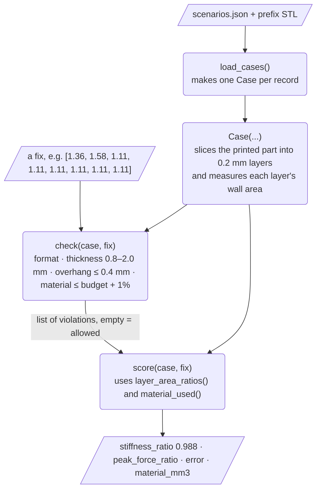
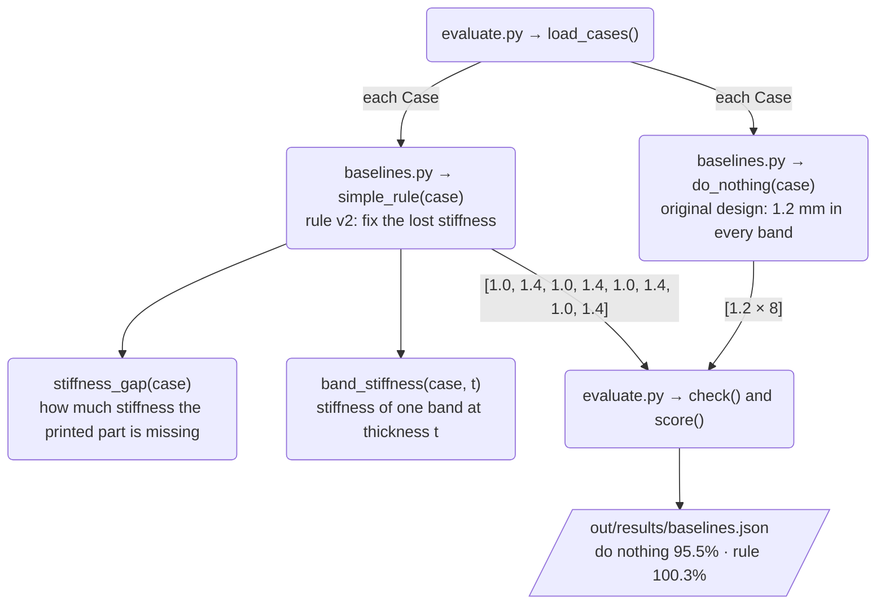
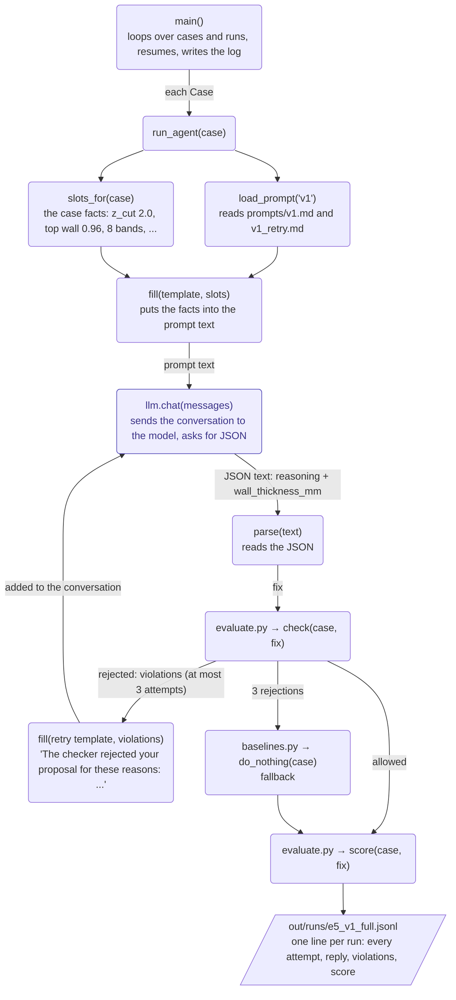
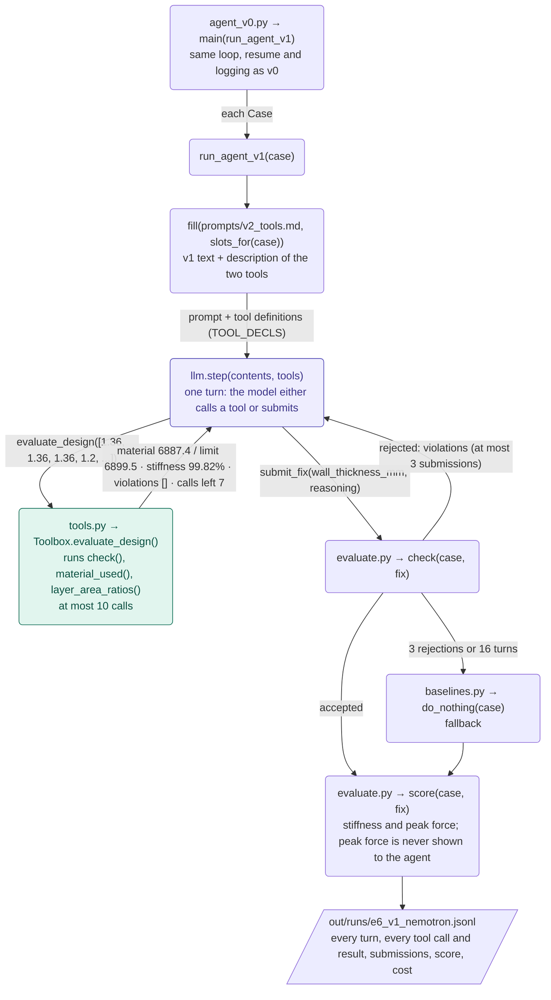
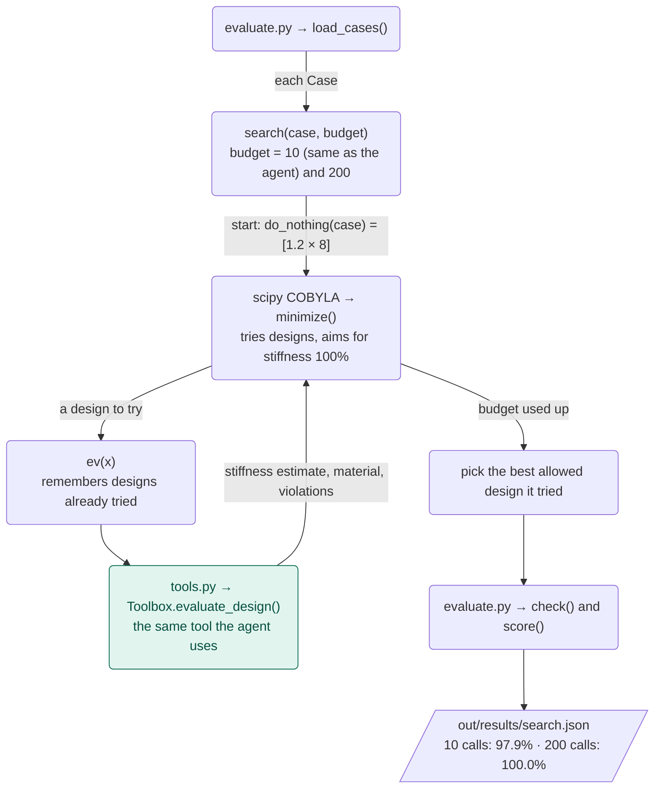
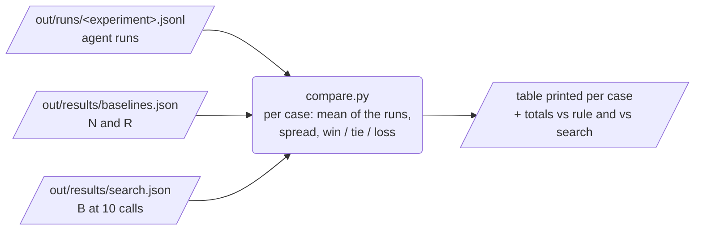
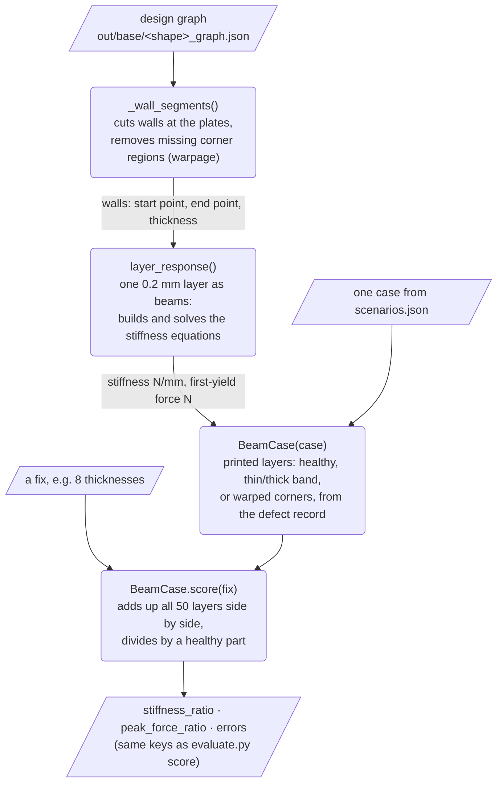
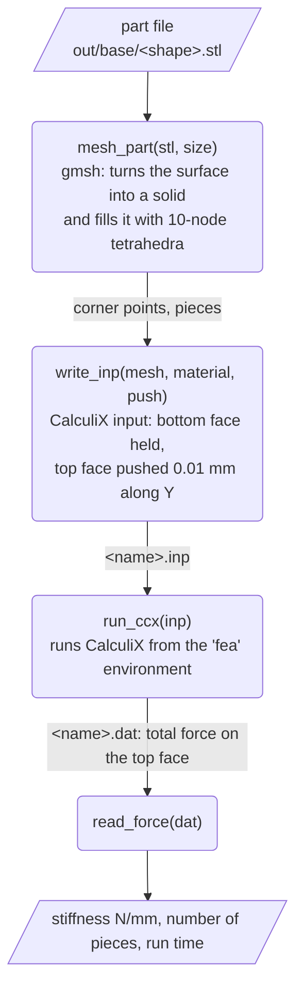

# Pipeline diagrams

## Quick reminder of terms

- **Case:** one test problem, such as a part with under-extrusion that paused at 2 mm.
- **Fix:** a list of wall thicknesses for the part left to print, one per 1 mm of height.
- **Checker:** our code that tests whether a fix follows the rules. No AI.
- **Score:** our formulas estimating the finished part's stiffness and peak force, as a % of a healthy part. No AI.
- **Do nothing (N):** keep printing the original design.
- **Simple rule (R):** a fixed recipe we wrote that cancels the stiffness the defect added or removed. No AI.
- **A0 (agent v0):** the AI, with no calculator.
- **A1 (agent v1):** the AI, with up to 10 calculator uses.
- **Calculator (`evaluate_design`):** reports a design's plastic use, estimated stiffness and rule problems.
- **10-call search (B):** our math program, with no AI, that tries designs using the same calculator, up to 10 times.
- **E0, E1, ...:** our numbered experiments.
- **Thinking off:** a model setting that skips the AI's long hidden reasoning.

## Start here: the four questions for every step

For each step: what do we have before it, what does it change, what do we have after it, and is it the AI or plain code? Example case: under-extrusion starting at 10% of the height.

### The building blocks

| Step | Before | What it changes | After | AI or code |
|---|---|---|---|---|
| **Build one case** | The healthy design, plus a defect type and start height | Builds the part with the defect and removes everything above the pause height (2.0 mm) | A 3D file of the printed part, and the facts of the case (8 mm left, budget 6831 mm³) | Code |
| **Propose a fix** | The facts of a case | Chooses a wall thickness for each remaining 1 mm band; the method varies (see below) | A list of 8 thicknesses | Depends on the method |
| **Check the fix** | One list of thicknesses | Nothing; it tests the rules (0.8 to 2.0 mm, at most 0.4 mm thicker than the band below, plastic within budget + 1%) | Allowed, or rejected with reasons | Code |
| **Score the fix** | The printed part plus the list of thicknesses | Nothing; it estimates the finished part with formulas | Stiffness % and peak force % of a healthy part | Code |
| **Compare** | Results of all methods, per case | Lines the methods up | A table, and wins, ties and losses | Code |

### The methods that propose a fix

| Method | What it gets | How it decides | AI or code |
|---|---|---|---|
| **N: do nothing** | The original design | Keeps 1.2 mm in every band | Code |
| **R: simple rule v2** | The printed part's measured stiffness gap | Follows a fixed recipe to cancel the gap | Code |
| **A0: agent v0** | The facts of the case in a prompt | Reasons and answers; hears back only if it broke a rule (3 tries) | AI, with code checking it |
| **A1: agent v1** | The same, plus a calculator it can use 10 times | Tries designs, reads the numbers, then submits | AI, with code checking it |
| **B: search** | The same calculator, with the same 10 uses | An optimizer tries designs and keeps the best allowed one | Code |

### The experiments

| Experiment | Before | What we changed | What came out | AI or code |
|---|---|---|---|---|
| **E0** | Healthy designs and defect definitions | Built the first test set | 12 cases, all pass the part checks | Code |
| **E1** | The 12 cases, with no repair | Tried "do nothing" | Under-extrusion 95.5%, over-extrusion 107.2%, warpage 99.5%; layer shift 100.0%, because the score can't see it | Code |
| **E2** | E1's damage numbers | Tried simple rule v1 (correct every remaining band by the lost thickness) | It overcorrects; under-extrusion breaks the rules | Code |
| **E3** | E2's failure | Rule v2 (correct the lost stiffness instead) | About 100% in most cases, except late under-extrusion. This is the bar to beat | Code |
| **E4** | The bar from E3 | Added the AI, on one case, to test that the code runs | It runs: 98.8% | AI |
| **E5** | E4's working loop | Ran all 12 cases, 3 times each | 0 wins, 6 ties, 6 losses against the rule; answers vary between runs | AI |
| **E6** | E5's finding that the agent can't tell how close it is | Adds the calculator, and compares with search B | See `docs/progress.md` (agent v1 beat v0, did not beat the rule) | AI, plus code for B |
| **E7 (trust checks for the beam model)** | The 12 cases and the formula score | Scores the same fixes with the new beam model (diagram 8) and compares it with the textbook formula on healthy parts | Not known yet | Code |

---

One diagram per stage of the pipeline and per agent version, naming the real functions (file → function) and what goes in and comes out, with real example values. These are for reference when debugging or changing the code. A new diagram is added for every new agent version or experiment setup, and old ones are kept, so each experiment's setup can always be looked up.

The diagrams are written in Mermaid. GitHub shows them as pictures. In VS Code, install the extension "Markdown Preview Mermaid Support" and open the Markdown preview (Ctrl+Shift+V).

**How to read them:**
- Rounded boxes are **functions** (`file.py → function()`), with one line on what they do.
- Slanted boxes are **files or data** going in or out.
- Purple boxes are where the **AI model** is called. Teal boxes are **tools** the AI can call. Everything else is plain Python.
- The words on an arrow say what is passed along it.

Example case used throughout: `reentrant_under_extrusion_medium_z10` (under-extrusion from 1.0 to 2.0 mm, printer paused at 2.0 mm, 8 bands of 1 mm left to print).

| # | Diagram | Used by experiments |
|---|---|---|
| 1 | Building the repair cases | E0 |
| 2 | The judge (checker and score) | every experiment |
| 3 | Baselines N and R | E1, E2, E3 |
| 4 | Agent v0 (A0) | E4, E5 |
| 5 | Agent v1 (A1) | E6 |
| 6 | Non-AI search (B) | E6 |
| 7 | Comparing results | E5, E6 |
| 8 | Beam model of the walls (fast FEA calculator) | E7 |

---

## 1. Building the repair cases (E0)
Run: `python agent/scenarios.py` (plain Python, about 9 s). Builds each defective part, cuts it where the printer would pause, and writes down the facts of each case.

---

## 2. The judge: checker, then score (every experiment)
File: `agent/evaluate.py`. Every method's fix goes through these same functions. A fix is always `{"wall_thickness_mm": [one number per remaining 1 mm band]}`.

- `layer_area_ratios(case, fix)`: wall area of every 0.2 mm layer (the printed ones, then the proposed ones) divided by a healthy layer's.
- Stiffness = average of (ratio³). Peak force = average of (ratio²). Both are relative to a healthy part, so 1.0 = 100%.
- `material_used(case, fix)`: plastic in the proposed bands, in mm³.

---

## 3. Baselines N (do nothing) and R (simple rule) (E1, E2, E3)
Run: `python agent/baselines.py` (plain Python, about 9 s). No AI.

---

## 4. Agent v0, A0 (E4, E5)
Run: `python agent/agent_v0.py --runs 3 --experiment e5_v1_full` (uses the AI). File: `agent/agent_v0.py`.

Example from E5: allowed on the first attempt in 35 of 36 runs. Mean result 0 wins, 6 ties, 6 losses against the simple rule.

---

## 5. Agent v1, A1 (E6)
Run: `python agent/agent_v1.py --runs 3 --experiment e6_v1_nemotron` (uses the AI, free Nemotron with thinking off). File: `agent/agent_v1.py`; the tool is in `agent/tools.py`.

Example from the one-case test (`out/runs/smoke_or_v1.jsonl`): 10 tool calls, best allowed design tried was 99.8%, but it submitted an unchecked design that scored 98.8%. That test showed the budget without the checker's +1%, so 6887.4 mm³ looked over budget although it was allowed. The tool now reports the real limit (6899.5 mm³).

---

## 6. Non-AI search, B (E6)
Run: `python agent/search.py` (plain Python, about 40 s). File: `agent/search.py`.

The rules the prompt states in words (thickness range, overhang) the search checks itself with `overhang_margins(x)` and simple limits, just as the agent can read them in its prompt.

---

## 7. Comparing results (E5, E6)
Run: `python agent/compare.py out/runs/<experiment>.jsonl` (plain Python, instant).

A tie means the agent's mean error is within 0.5 percentage points of the other method's. It refuses to report if runs are missing, unless `--partial` is given.

---

## 8. Beam model of the walls: the fast FEA calculator (E7)
File: `fea/beam.py`. Plain code, no AI. FEA here means a computer simulation of how the part deforms under load (decision D12).

**The four questions:**

| | Plain answer | Example (healthy re-entrant part) |
|---|---|---|
| What do we have before it? | The design graph (points joined by walls), the case's defect record, and a fix (one wall thickness per remaining 1 mm band) | `out/base/reentrant_graph.json`, 114 walls |
| What does it change? | Nothing in the design. It turns every wall into a beam that can stretch and bend, holds the bottom plate still, pushes the top plate down along Y, and solves for the force | Push of 0.01 mm |
| What do we have after it? | Stiffness and a peak-force estimate (force when the most-stressed wall first reaches the plastic's yield stress), each as a % of a healthy part | Whole healthy part: 656 N/mm, first yield at 405 N (placeholder PLA values; only the % are meaningful) |
| AI or code? | Code | About 0.01 s per layer |

- **Sees, unlike the formula:** where each wall is (corner walls vs middle walls), and warpage as missing walls near the corners of the lowest layers.
- **Still blind to:** layer shift (each layer alone looks healthy), layer bonding, wall-to-wall contact and large crushing. The 3D CalculiX judge is planned for those.
- **Plates:** the walls are held where they meet the solid end plates (no sliding, no turning), because the plates are stiff printed bars.
- **E7 checks:** (1) solver against exact answers for single beams; (2) healthy parts against the Gibson & Ashby formula, target within 10%; (3) for each defect type, does the score tell a fix apart from doing nothing.

## 9. 3D solid model: the planned judge (E8, healthy parts only)
File: `fea/solid3d.py` (written during development; it moves to the locked `fea/judge/` folder only after Amber approves it). Plain code, no AI. Tools: gmsh splits the part into small 4-cornered pieces (tetrahedra), and CalculiX solves how every piece moves.

**The four questions:**

| | Plain answer | Example (healthy re-entrant part) |
|---|---|---|
| What do we have before it? | The part's 3D file (STL) and the plastic's stiffness (placeholder PLA: 3,500 MPa, Poisson's ratio 0.35) | `out/base/reentrant.stl` |
| What does it change? | Nothing in the design. It fills the part with small pieces, holds the bottom face (Y = 0) still, pushes the top face (Y = 50 mm) down along Y by 0.01 mm, and solves for the force | Piece size about 0.6 mm, so about 2 pieces across a 1.2 mm wall |
| What do we have after it? | Stiffness = force / push, in N/mm; later, as a % of a healthy part | Beam model gave 656 N/mm; the 3D number is what E8 measures |
| AI or code? | Code | Probably seconds to a few minutes per part; E8 measures it |

**E8 checks (healthy parts only):**
1. **Tool check:** a solid 10 mm block, where the exact answer is known (stiffness × area ÷ length = 35,000 N/mm).
2. **Piece-size check:** healthy re-entrant at 3 piece sizes. Purpose: smaller pieces are more accurate but slower, so we use the largest size whose answer is within 2% of the next smaller size.
3. **Healthy parts against the beam model and the formula:** hexagon, re-entrant, triangle at the chosen size. Purpose: see whether the fast calculator (beam model) and the judge roughly agree. If they disagree a lot, the agent's calculator points it at the wrong target. No pass mark: the 3D model holds the plates differently and includes the 10 mm depth, so some gap is expected, and the result is reported as it is.

- **Sees, unlike the beam model:** the full 3D solid, including how each layer sits on the one below. That is what should let a later version see layer shift (E9, after Amber reviews E8).
- **Still blind to:** weak bonding between layers (layers are treated as one solid), permanent bending and crushing (stiffness only), and the real PLA values until Yichen's data arrives.
